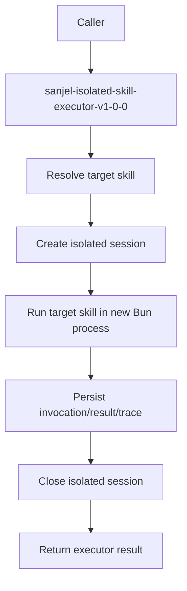

# Isolated Skill Executor Logic

This skill only documents the high-level relationship between the executor and the target skill it launches.

**Main input**: `targetSkillId | targetSkillPath`, `targetInput`  
**Main output**: executor `result.json`, target run artifacts under `.skill-runs/`

