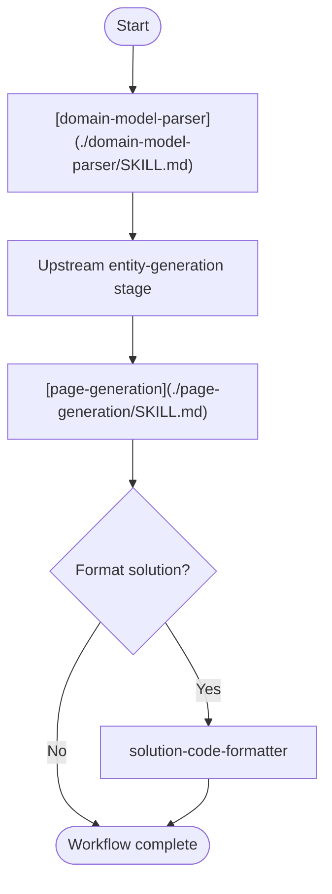

## Overview

Coordinates the sanjel-coding skill suite that transforms a domain model into downstream artifacts such as metadata JSON, SQL schema, page-layer files, and optional formatting results. This orchestrator manages contract hand-offs between the skills in this subtree and allows upstream architecture or entity generation stages to be provided externally when they are not implemented as local skills.

## Actor

Senior .NET Architect

## Type

Orchestrator

## Responsibility

Coordinate the sanjel-coding skill suite and manage the contract hand-offs between domain parsing, database schema generation, page generation, and optional solution formatting.

## Contracts

- The authoritative input contract is defined in [in.json](in.json).
- The authoritative output contract is defined in [out.json](out.json).

## Flow Intent

Start from a domain model markdown file, derive reusable metadata, generate an optional SQL schema, hand off generated entities to page-generation, and optionally format the solution at the end of the workflow.

## Flow

## Execution Guidance

1. Resolve `domainModelPath`, `metadataPath`, `entityDirectoryPath`, `schemaOutputPath`, `solutionPath`, and `formatSolution` from [in.json](in.json).
2. Invoke `domain-model-parser` when metadata is not already available; this dispatch skill also coordinates optional SQL schema generation when `schemaOutputPath` is provided.
3. Treat architecture and entity generation as an upstream hand-off when those stages are implemented outside this skill subtree; the resulting entity directory becomes the input contract for `page-generation`.
4. Invoke `page-generation` only after the entity directory is available and map its outputs into this skill's `pageArtifactPaths` and `generatedArtifacts`.
5. Invoke `solution-code-formatter` only when `formatSolution` is true and a solution path is available or auto-detectable.
6. If a downstream stage requires information that cannot be derived from upstream outputs, ask the user for the missing values before continuing.
