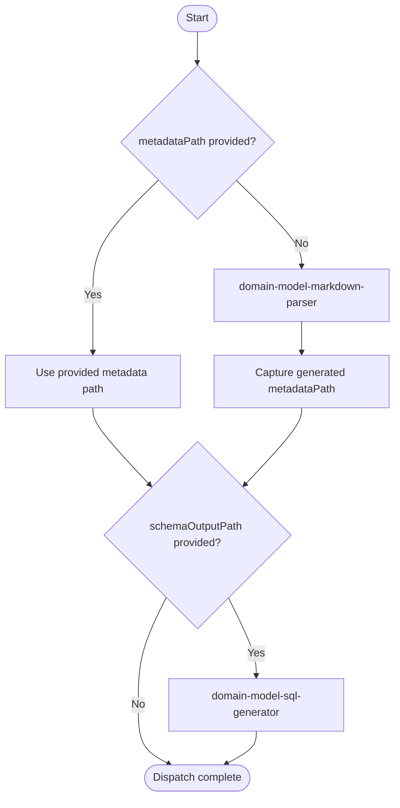

## Overview

Dispatches domain-model preprocessing for downstream code-generation workflows. If metadata is already provided, it reuses it directly. Otherwise, it invokes `domain-model-markdown-parser` to produce metadata JSON. When `schemaOutputPath` is requested, it also invokes `domain-model-sql-generator` on the resolved metadata.

## Actor

Developer / Code Generator

## Type

Dispatch

## Responsibility

Route domain-model parsing requests to the correct subskills and return resolved metadata and optional SQL schema artifacts.

## Contracts

- The authoritative input contract is defined in [in.json](in.json).
- The authoritative output contract is defined in [out.json](out.json).

## Flow Intent

Resolve metadata from either an existing file or markdown parsing, then optionally generate SQL DDL from that metadata, and expose stable artifact paths for downstream orchestrators.

## Flow

## Execution Guidance

1. Resolve `domainModelPath`, optional `metadataPath`, optional `metadataOutputPath`, optional `entityFilter`, and optional `schemaOutputPath` from [in.json](in.json).
2. If `metadataPath` is provided, treat it as the authoritative metadata input and skip markdown parsing.
3. If `metadataPath` is not provided, invoke `domain-model-markdown-parser` with `domainModelPath`, optional `metadataOutputPath`, and optional `entityFilter`.
4. Capture and expose the resolved `metadataPath` regardless of whether it came from input or markdown parsing.
5. If `schemaOutputPath` is provided, invoke `domain-model-sql-generator` with the resolved `metadataPath` and `schemaOutputPath`.
6. Expose `schemaPath` only when SQL generation runs; otherwise return only metadata outputs.
7. Ask the user for missing `domainModelPath` only when metadata is not supplied and markdown parsing cannot be executed.
