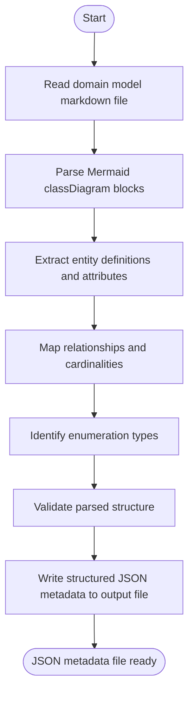

## Overview

Parses a domain model markdown document and its Mermaid `classDiagram` blocks into normalized metadata JSON for downstream code generation and schema generation.

## Actor

Developer / Code Generator

## Type

Task

## Responsibility

Transform a domain model markdown document into reusable metadata JSON.

## Contracts

- The authoritative input contract is defined in [in.json](in.json).
- The authoritative output contract is defined in [out.json](out.json).

## Flow Intent

Read a domain model markdown file, extract entities, relationships, enums, and descriptive metadata, optionally filter the result to a requested subset of entities, then emit a metadata JSON artifact.

## Flow

## Execution Guidance

1. Resolve `domainModelPath`, optional `outputPath`, and optional `entityFilter` from [in.json](in.json).
2. Run `bun run scripts/parse-domain-model.ts <domainModelPath> [outputPath] [entityFilter]`.
3. Parse Mermaid `classDiagram` blocks, descriptive sections, and enum definitions to build entity, relationship, and enum metadata.
4. Infer missing enum definitions from attribute type references before emitting the final metadata object.
5. If `entityFilter` is provided, limit the emitted metadata to the requested entities and recompute relationships, enums, and statistics.
6. Write the metadata JSON artifact to the resolved output path and ensure the result conforms to [out.json](out.json).
7. Ask the user for missing input paths or filters when they cannot be derived from the surrounding workflow.