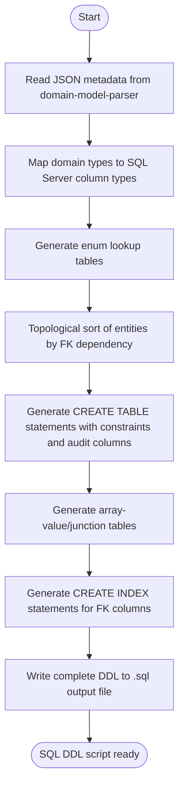

## Overview

Generates SQL Server DDL scripts from the JSON metadata produced by `domain-model-parser`. The skill reads entity definitions, relationships, and enums to produce an ordered SQL Server schema artifact with enum lookup tables, entity tables, array-value tables, indexes, and foreign key constraints.

## Actor

Developer / Code Generator

## Type

Task

## Responsibility

Generate SQL Server DDL from domain-model-parser metadata.

## Contracts

- The authoritative input contract is defined in [in.json](in.json).
- The authoritative output contract is defined in [out.json](out.json).

## Flow Intent

Read metadata JSON, resolve dependency order, generate enum lookup tables and entity tables, emit array-value tables and foreign key constraints, then write the final DDL artifact to disk.

## Flow

## Execution Guidance

1. Resolve `metadataPath` and optional `outputPath` from [in.json](in.json).
2. Run `bun run scripts/generate-sql-schema.ts <metadataPath> [outputPath]`.
3. Load metadata JSON, keep `entity` and `actor` records, and topologically sort the resulting tables by dependency.
4. Generate enum lookup tables, entity tables, array-value tables, nonclustered indexes, and foreign key constraints.
5. Write the complete DDL script to the resolved output path and map summary counts to [out.json](out.json).
6. Ask for an explicit output path only when the default `<metadata>.sql` naming is not acceptable in the current workflow.
