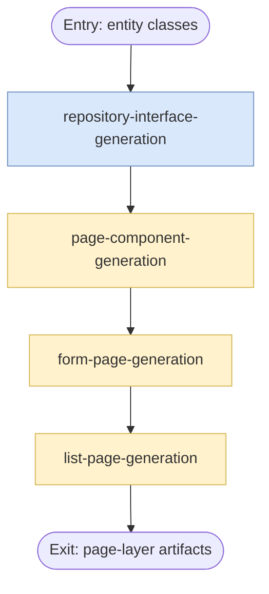

## Overview

Coordinates the ordered page-layer generation stages that consume generated entity classes and produce repository interfaces, shared components, form pages, and list pages. This skill documents the contract hand-offs between stages even when some concrete stage implementations live outside this subtree.

## Actor

Full Stack Developer

## Type

Orchestrator

## Responsibility

Coordinate page-layer generation stages and map upstream entity artifacts into downstream repository and page outputs.

## Contracts

- The authoritative input contract is defined in [in.json](in.json).
- The authoritative output contract is defined in [out.json](out.json).

## Flow Intent

Use generated entity classes as the upstream contract, then sequence repository, shared component, form page, and list page generation stages so each stage receives the artifacts produced by the previous stage.

## Flow

## Execution Guidance

1. Resolve `entityDirectoryPath`, `repositoryOutputPath`, `pageOutputPath`, and `projectName` from [in.json](in.json).
2. Use the entity directory as the authoritative upstream contract for the orchestration flow.
3. Map repository interface outputs into the shared component stage, then map shared component outputs into form-page generation, and finally map form-page outputs into list-page generation.
4. If namespace rules, project names, or output directories cannot be inferred from upstream outputs, ask the user for the missing values before continuing.
5. Emit repository interface paths, shared component paths, form page paths, list page paths, and the aggregate artifact list defined in [out.json](out.json).
6. Keep this skill focused on sequencing and contract mapping rather than implementing page-generation business logic directly.
---
name: page-generation
description: Orchestrates the page-layer generation stages that consume generated entity classes and produce repository and page artifacts.
---

## Overview

Coordinates the ordered page-layer generation stages that consume generated entity classes and produce repository interfaces, shared components, form pages, and list pages. This skill documents the contract hand-offs between stages even when some concrete stage implementations live outside this subtree.

## Actor

Full Stack Developer

## Type

Orchestrator

## Responsibility

Coordinate page-layer generation stages and map upstream entity artifacts into downstream repository and page outputs.

## Contracts

- The authoritative input contract is defined in [in.json](in.json).
- The authoritative output contract is defined in [out.json](out.json).

## Flow Intent

Use generated entity classes as the upstream contract, then sequence repository, shared component, form page, and list page generation stages so each stage receives the artifacts produced by the previous stage.

## Flow

## Execution Guidance

1. Resolve `entityDirectoryPath`, `repositoryOutputPath`, `pageOutputPath`, and `projectName` from [in.json](in.json).
2. Use the entity directory as the authoritative upstream contract for the orchestration flow.
3. Map repository interface outputs into the shared component stage, then map shared component outputs into form-page generation, and finally map form-page outputs into list-page generation.
4. If namespace rules, project names, or output directories cannot be inferred from upstream outputs, ask the user for the missing values before continuing.
5. Emit repository interface paths, shared component paths, form page paths, list page paths, and the aggregate artifact list defined in [out.json](out.json).
6. Keep this skill focused on sequencing and contract mapping rather than implementing page-generation business logic directly.
