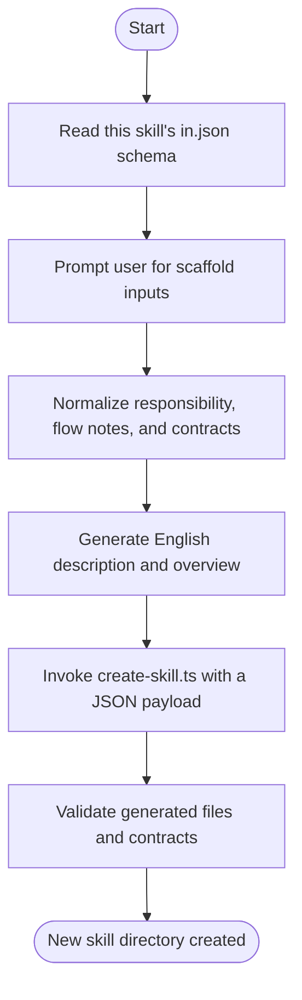

## Overview

Scaffolds a new skill under `.github/skills/` using contract-first conventions. The creator collects the new skill's responsibility, execution mode, and input/output contracts, normalizes informal notes into concise English, then generates `SKILL.md`, `in.json`, `out.json`, and optional `scripts/` or `templates/` assets based on the selected type.

## Actor

Skill Architect

## Type

Task

## Skill Types

| Type | Responsibility | Implementation Rule | Scaffolded Assets |
|---|---|---|---|
| **Orchestrator** | Coordinate other skills to achieve an overall goal | Must not implement business logic directly; any deterministic logic should be limited to contract adaptation | `SKILL.md`, `in.json`, `out.json` |
| **Task** | Execute one concrete unit of business logic | May be AI-driven or script-driven; deterministic work should live in `scripts/*.ts` and run with Bun | `SKILL.md`, `in.json`, `out.json`, optional `scripts/`, optional `templates/` |

## Guiding Principles

1. Every skill MUST be classified as either an **Orchestrator** or a **Task**.
2. Orchestrator skills MUST coordinate other skills and MUST NOT implement business logic directly. Their behavior should be described through the **Flow** and **Execution Guidance** sections.
3. Task skills MUST implement one concrete unit of business logic. When the work is deterministic, the implementation SHOULD live in `scripts/*.ts` and run with Bun.
4. Every skill MUST define its input contract in `in.json` and its output contract in `out.json`.
5. `in.json` and `out.json` describe data shapes and constraints, not runtime values.
6. Contract files SHOULD use the same field-definition style as this skill, including `type`, `description`, and `values` for enum fields when applicable.
7. Scripts MUST accept inputs through command-line arguments and MUST emit outputs through standard output in a structured form that matches `out.json`.
8. Template files MAY be stored in `templates/` when reusable output patterns are needed.
9. Orchestrator skills MUST map upstream outputs into downstream inputs by combining the upstream `out.json`, the upstream output values, and the downstream `in.json`.
10. If a downstream skill requires data that cannot be derived from previous outputs, the skill MUST ask the user for the missing inputs and SHOULD prefer choice-based prompts over free-form typing when practical.
11. The **Execution Guidance** section MUST complement the **Flow** section instead of restating it. It should clarify mapping rules, missing-input handling, decision logic, and execution conventions.

## Contract Conventions

Use the following schema style when generating `in.json` and `out.json`:

```json
{
	"fieldName": {
		"type": "string | number | boolean | enum | object | array",
		"description": "What the field means",
		"values": [ "Only required for enum fields" ]
	}
}
```

- Use `values` only when `type` is `enum`.
- Prefer concise field names and explicit descriptions.
- Keep contracts focused on the single responsibility of the skill.

## Flow



## Execution Guidance

1. Read this skill's `in.json` to collect `name`, `type`, `actor`, `AIDriven`, `usesTemplates`, `responsibility`, `flowSummary`, `inputContractJson`, and `outputContractJson`.
2. If the user's notes are informal or written in another language, normalize them into concise English before generating the new skill artifacts.
3. Generate `description` and `overview` from `name`, `type`, `responsibility`, and `flowSummary`.
4. Normalize `inputContractJson` and `outputContractJson` into valid JSON objects before invoking the scaffold script.
5. Invoke the scaffold script with a single JSON payload:

```bash
bun scripts/create-skill.ts '<json-payload>'
```

6. Ensure the generated skill always includes `SKILL.md`, `in.json` and `out.json`.
7. Create `scripts/` only for Task skills with deterministic execution, and create `templates/` only when reusable templates are required.
8. For Orchestrator skills, make the generated `SKILL.md` explicitly describe output-to-input mapping, missing-input follow-up questions, and the rule that no direct business logic should be implemented in the orchestrator.
9. If required contract details are missing, ask follow-up questions before invoking the script. Prefer enum-like choices when the missing input can be constrained.

## File Structure

### Standard Skill Directory Layout

```text
skill-name/
├── SKILL.md           # Skill definition and execution guidance
├── in.json            # Authoritative input contract
├── out.json         # Authoritative output contract
├── scripts/           # Optional, Task type only, for deterministic Bun scripts
└── templates/         # Optional, when reusable output templates are required
```
