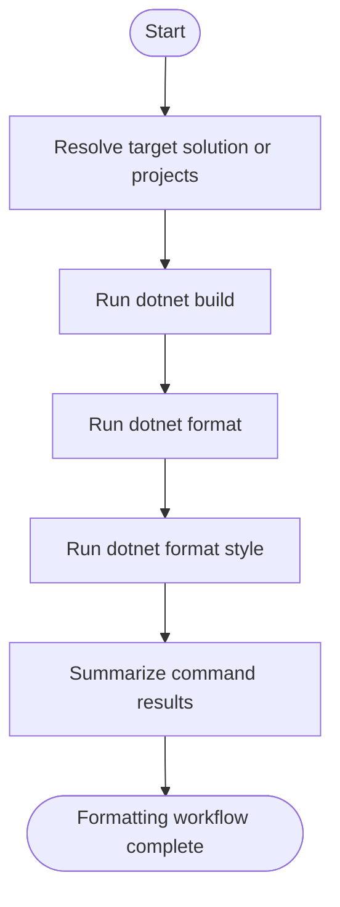

## Usage

Formats either an entire solution or a selected set of projects by running `dotnet build`, `dotnet format`, and `dotnet format style`, then returns a summary of which commands succeeded or failed.

## Actor

Full Stack Developer

## Type

Task

## Responsibility

Format a solution or a selected set of projects and report the formatting outcome.

## Contracts

- The authoritative input contract is defined in [in.json](in.json).
- The authoritative output contract is defined in [out.json](out.json).

## Flow Intent

Resolve the formatting target, run the build and formatting commands in order, and summarize all command results so the caller can distinguish full success from partial success.

## Flow

## Execution Guidance

1. Resolve `formatMode`, `solutionPath`, and `projectPaths` from [in.json](in.json).
2. When `formatMode` is `auto-detect`, let the script discover the project root and `.slnx` file.
3. For selective formatting, invoke `bun run scripts/format-solution.ts --projects <paths...>`.
4. Otherwise invoke `bun run scripts/format-solution.ts [solutionPath]` and allow the script to run `dotnet build`, `dotnet format`, and `dotnet format style` in sequence.
5. Map the resulting command summary into the fields defined in [out.json](out.json).
6. Report partial failures as part of the output contract instead of hiding them.